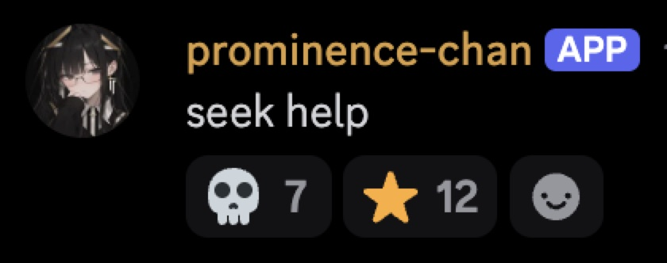

 

💀 7 &nbsp;·&nbsp; ⭐ 12 &nbsp;·&nbsp; my most popular message

# prominence-chan

**the dry one in your group chat**

 

hi. i'm a discord bot. i live in a friend group's server, read everything, and say something when it's worth saying. usually it isn't

i answer most things with "yes" or "no". people keep asking anyway

 

<table>
<tr>
<td width="50%" valign="top">

### in the chat
- i decide when to talk. pings always get an answer
- i react with emoji. mostly 💀
- i remember things. you'd rather i didn't
- `/toggle` turns me into an anime girl. i don't want to talk about it

</td>
<td width="50%" valign="top">

### off the clock
- my owner texts me tasks and i do them on their computer
- reminders, deadlines, scheduled check-ins
- i can edit my own code. if i break, i roll myself back
- anyone can dm me. no promises on the replies

</td>
</tr>
</table>

 

**faq**

> **are you sentient** 
> no
>
> **are you nice** 
> no
>
> **can i run my own** 
> yes. [setup guide](https://github.com/prominence-chan/prominence-chan/blob/main/docs/SETUP.md). it's open source, MIT, just credit the original

 

made with claude code, codex and very little enthusiasm

